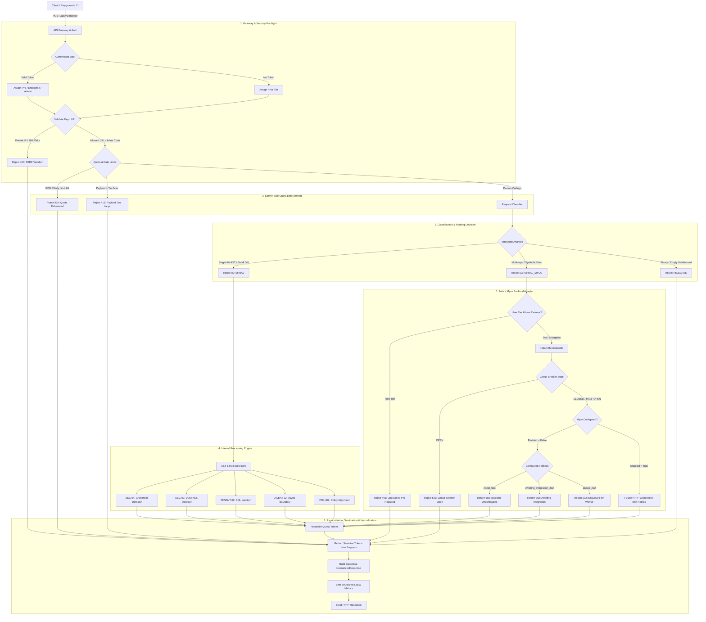
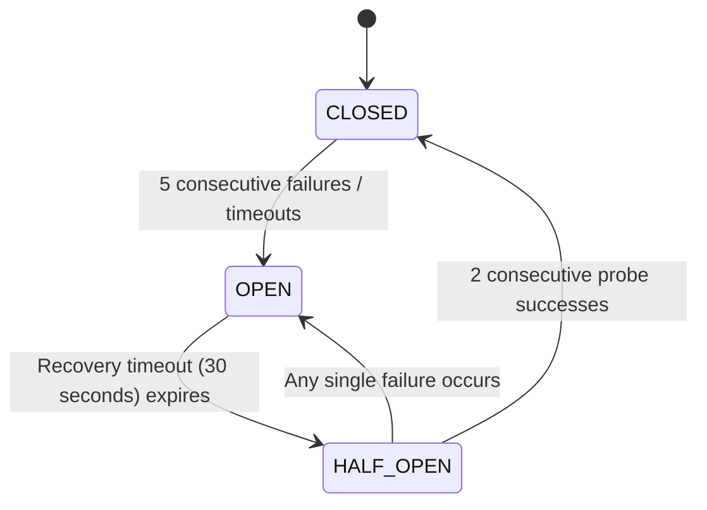

# Scalable API Request Pipeline with Future Myco Backend Integration

## 1. Architectural Overview and Request Lifecycle

The system provides a unified, highly scalable request processing pipeline designed to ingest, validate, classify, meter, and route code analysis workloads. The pipeline handles standard AST and static policy checks internally, while providing an extensible adapter boundary for a future enterprise Myco backend without modifying the core pipeline when that backend becomes available.

```
+-------------------------------------------------------------------------------------------------------------------+
|                                                 API GATEWAY                                                       |
| - Pre-flight Content-Length inspection        - Identity & API Key authentication                                 |
| - Plan/tier assignment (Free, Pro, Enterprise)- Input schema parsing & sanitization                              |
+-------------------------------------------------------------------------------------------------------------------+
                                                          |
                                                          v
+-------------------------------------------------------------------------------------------------------------------+
|                                            SECURITY & SSRF GUARD                                                  |
| - SSRF URL allowlisting & IP subnet check     - Anti-injection & null-byte stripping                              |
| - Prohibits private/cloud metadata ranges     - Untrusted string boundary isolation                               |
+-------------------------------------------------------------------------------------------------------------------+
                                                          |
                                                          v
+-------------------------------------------------------------------------------------------------------------------+
|                                       USAGE METERING & QUOTA SERVICE                                              |
| - Pre-flight payload, token, & line check     - Sliding-window rate limiting (RPM/RPD)                            |
| - Concurrency slot reservation                - Daily token compute budget reservation                            |
+-------------------------------------------------------------------------------------------------------------------+
                                                          |
                                                          v
+-------------------------------------------------------------------------------------------------------------------+
|                                        REQUEST CLASSIFIER & DETECTOR                                              |
| - Structural AST and format detection         - Diff line & file count calculation                                |
| - Capability boundary assessment              - Routing determination: INTERNAL vs EXTERNAL_MYCO vs REJECTED      |
+-------------------------------------------------------------------------------------------------------------------+
                                 /                                                  \
                                /                                                    \
        +-----------------------------------------+            +---------------------------------------------------+
        |       INTERNAL PROCESSING ENGINE        |            |           FUTURE MYCO BACKEND ADAPTER             |
        | - Single-file & multi-context AST rules |            | - BackendProvider abstraction                     |
        | - Credential exposure (SEC-04)          |            | - Circuit Breaker (Closed, Open, Half-Open)       |
        | - DOM/XSS vulnerabilities (SEC-02)      |            | - Configurable fallback (503 / 202 Queued)        |
        | - Multi-tenant SQL injection (TENANT-02)|            | - Extensible HTTP client hook                     |
        | - Unhandled async boundaries (AGENT-12) |            | - Zero functional mocks in production             |
        | - In-memory execution metrics           |            |                                                   |
        +-----------------------------------------+            +---------------------------------------------------+
                                 \                                                    /
                                  \                                                  /
+-------------------------------------------------------------------------------------------------------------------+
|                                     QUOTA RECONCILIATION & TELEMETRY                                              |
| - Reconciles estimated vs actual tokens       - Releases active concurrency slot                                  |
| - Latency histogram & error counts            - Privacy-aware structured audit logging                             |
+-------------------------------------------------------------------------------------------------------------------+
                                                          |
                                                          v
+-------------------------------------------------------------------------------------------------------------------+
|                                      CANONICAL RESPONSE NORMALIZER                                                |
| - Uniform JSON response contract              - Automatic credential & token masking (sk_live_, AKIA, ghp_)       |
| - Structured findings & merge-blocking flags  - Quota balance & upgrade guidance metadata                        |
+-------------------------------------------------------------------------------------------------------------------+
```

### Request Lifecycle Stages

1. **Ingress & Gateway Identification**: The request arrives at `/api/v1/analyze`. The API Gateway inspects `Content-Length` headers before body consumption to reject oversized payloads. It inspects `Authorization` or `X-API-Key` headers to resolve identity into a `UserContext` (`userId`, `orgId`, `tier`, `clientIp`). If unauthenticated, it safely defaults to the `free` tier.
2. **Security & SSRF Interception**: If the request specifies remote repository targets (`repoUrl`), the URL is checked against SSRF policies (prohibiting RFC 1918 private subnets, localhost, and cloud metadata endpoints such as `169.254.169.254`). Untrusted code strings are sanitized to eliminate null-byte attacks and normalized to standard line endings without code execution.
3. **Upfront Usage Metering & Pre-Flight Reservation**: The request's characters, estimated tokens, file count, and diff lines are calculated. The Quota Service verifies all ceilings for the user's plan. A concurrency slot is reserved, sliding-window RPM counters are updated, and daily tokens are reserved before computationally heavy AST parsing or network routing occurs.
4. **Structural Classification**: The Request Classifier parses inputs without executing untrusted code. It determines whether the workload falls within internal AST/policy verification boundaries or requires external capabilities (multi-repository dependency indexing, whole-project symbolic execution).
5. **Route Enforcement**:
   - If classified as `INTERNAL`: The Internal Processing Engine analyzes syntax trees, detects credential leaks, SQL injection patterns, DOM/XSS vulnerabilities, unhandled async boundaries, and PRD policy mismatches.
   - If classified as `EXTERNAL_MYCO`: The router verifies whether the user's plan permits external processing. If permitted, the request is dispatched to the `FutureMycoAdapter`. If Myco is unconfigured, the adapter invokes its configured policy (`reject_503`, `awaiting_integration_202`, or `queue_202`).
   - If classified as `REJECTED`: Returns an informative 400 Bad Request or 422 Unprocessable Entity.
6. **Quota Reconciliation**: The actual tokens consumed during analysis are compared against the upfront estimate. The daily quota is adjusted by the delta, and the active concurrency counter is decremented.
7. **Response Normalization & Sanitization**: Findings and metadata are formatted into a canonical JSON response. All sensitive tokens (Stripe keys, AWS access keys, GitHub tokens, private keys) are redacted from evidence snippets and audit logs.

---

## 2. Pipeline Architecture Diagram



---

## 3. Routing and Classification Decision Matrix

The classifier uses structural, syntactic, and capability markers rather than basic keyword checks:

| Input Characteristics | Required Capabilities | Classified Route | Decision Rationale |
| :--- | :--- | :--- | :--- |
| Single `.ts`, `.tsx`, `.js`, `.py` file (<= 30 KB) | Static AST tokenization, regex security rules | `INTERNAL` | Fully supported by internal AST engine; no remote resolution required. |
| Single file + up to 5 context files (PRD, policy JSON) | In-memory multi-context policy alignment | `INTERNAL` | Context fits within internal memory boundary; verified locally. |
| Unified Git Diff (<= 500 lines) | Delta parser, modified line tracking | `INTERNAL` | Git diff headers and hunks parsed internally without external indexing. |
| Multi-repository dependency reference | Cross-repo symbol resolution, dependency graph | `EXTERNAL_MYCO` | Requires whole-organization indexing not available in single-node AST engine. |
| Full-repo repository URL without inline code | Remote cloning, complete repository indexing | `EXTERNAL_MYCO` | Requires dedicated worker pool and persistent disk/graph storage. |
| Explicit `cross_repo_graph` or `deep_symbolic_execution` | Inter-procedural symbolic taint analysis | `EXTERNAL_MYCO` | Dynamic symbolic execution exceeds internal rule engine capability. |
| Large project (> 10 files or > 5,000 diff lines) | Distributed graph indexing | `EXTERNAL_MYCO` | Exceeds internal compute constraints; routed to scalable backend. |
| Compiled binary or null-byte asset (`\x00`) | Binary parser (unsupported) | `REJECTED` | Source code is required; binary files cannot be parsed into AST nodes. |
| Empty payload or non-code text | Text parser (unsupported) | `REJECTED` | Missing code, diff, or repository target. |

### Classification Decision Algorithm

```
function classifyRequest(request):
    if contains_null_bytes(request.files):
        return REJECTED("Binary files not supported")

    if request.target_repo is present and no_inline_code(request):
        return EXTERNAL_MYCO("Full repository analysis requires external indexer")

    if "cross_repo_graph" in request.features or "deep_symbolic_execution" in request.features:
        return EXTERNAL_MYCO("Deep symbolic/cross-repo reasoning exceeds internal engine")

    if request.total_files > 10 or request.diff_lines > 5000:
        return EXTERNAL_MYCO("Large codebase payload requires distributed indexing")

    if request.primary_file matches (TS, JS, PY, JSON, YAML, DIFF):
        return INTERNAL("Matches internal AST and static verification capabilities")

    return REJECTED("Unrecognized source format")
```

---

## 4. Backend Adapter Interfaces and Data Contracts

The backend provider interface isolates all external transport, retry, and vendor-specific protocol details from the API request pipeline.

### Provider Abstraction Interface (Python / TypeScript Definition)

```typescript
/**
 * Canonical Request contract sent to external backend providers.
 */
export interface BackendRoutingRequest {
  requestId: string;
  userId: string;
  orgId: string;
  tier: "free" | "pro" | "enterprise" | "admin";
  targetRepository?: string;
  prNumber?: number;
  primaryFile?: {
    path: string;
    content: string;
  };
  contextFiles: Array<{
    path: string;
    content: string;
  }>;
  diffText?: string;
  requestedFeatures: string[];
  timeoutSeconds: number;
  clientMetadata: Record<string, unknown>;
}

/**
 * Standardized Response contract returned by all backend adapters.
 */
export interface BackendRoutingResponse {
  requestId: string;
  providerId: string;
  status: "completed" | "queued" | "awaiting_integration" | "rejected" | "failed";
  statusCode: number;
  findings: AnalysisFinding[];
  summary: {
    totalFindings: number;
    criticalCount: number;
    highCount: number;
    mediumCount: number;
    cleanVerified: boolean;
    providerMetadata?: Record<string, unknown>;
  };
  providerMetadata: Record<string, unknown>;
  errorMessage?: string;
  retryRecommended?: boolean;
}

/**
 * Abstract Backend Provider Interface.
 */
export interface IBackendProvider {
  readonly providerId: string;
  readonly providerName: string;
  readonly isEnabled: boolean;
  
  routeRequest(request: BackendRoutingRequest): Promise<BackendRoutingResponse>;
  checkHealth(): Promise<{ status: "CONNECTED" | "UNCONFIGURED" | "CIRCUIT_OPEN" | "DEGRADED" }>;
}
```

### Circuit Breaker States and Transitions

The `FutureMycoAdapter` incorporates an automated three-state Circuit Breaker:



1. **CLOSED**: Normal operation. All routed requests pass through to the adapter. Failures increment an internal counter.
2. **OPEN**: Tripped when failure threshold (default: 5) is reached. Subsequent requests fail immediately with HTTP 503 (`CIRCUIT_OPEN`), avoiding network timeouts and protecting downstream services.
3. **HALF_OPEN**: Once the recovery window (default: 30 seconds) elapses, the circuit breaker allows a limited number of test probes (default: 2). If both succeed, the circuit resets to `CLOSED`; if any fail, it resets to `OPEN`.

### Configuration Environment Variables

- `MYCO_BACKEND_ENABLED`: Boolean (`true` / `false`, default: `false`).
- `MYCO_BACKEND_URL`: URL to future backend gateway (`https://api.myco.internal/v1`).
- `MYCO_BACKEND_API_KEY`: Secure bearer credential stored in secret manager.
- `MYCO_BACKEND_TIMEOUT_SEC`: Float (default: `15.0`).
- `MYCO_BACKEND_MAX_RETRIES`: Integer (default: `2`).
- `MYCO_BACKEND_RETRY_BACKOFF`: Exponential factor (default: `0.5`).
- `MYCO_UNAVAILABLE_POLICY`: Configurable fallback policy (`reject_503`, `awaiting_integration_202`, `queue_202`).
- `CB_FAILURE_THRESHOLD`: Integer (default: `5`).
- `CB_RECOVERY_TIMEOUT_SEC`: Float (default: `30.0`).

---

## 5. Free-Tier Usage Limits and Resource Management

To prevent resource exhaustion from free-tier clients while offering frictionless developer evaluation, all limits are centralized, tier-delineated, and enforced strictly on the server before expensive analysis begins.

### Tier Quota Configuration Table

| Quota Dimension | Free Tier | Pro / Team Tier | Enterprise Tier | Administrative |
| :--- | :--- | :--- | :--- | :--- |
| **Max Request Body** | 512 KB | 4 MB | 20 MB | 50 MB |
| **Max Input Characters** | 30,000 chars | 300,000 chars | 2,000,000 chars | 10,000,000 chars |
| **Max Estimated Tokens** | 8,000 tokens | 75,000 tokens | 500,000 tokens | 2,500,000 tokens |
| **Max Files Per Request** | 5 files | 50 files | 500 files | 2,000 files |
| **Max PR Diff Lines** | 500 lines | 5,000 lines | 50,000 lines | 200,000 lines |
| **Requests Per Minute (RPM)** | 10 req/min | 60 req/min | 300 req/min | 1,200 req/min |
| **Requests Per Day (RPD)** | 150 req/day | 3,000 req/day | 50,000 req/day | 500,000 req/day |
| **Daily Token Budget** | 60,000 tokens | 1,500,000 tokens | 30,000,000 tokens | Unlimited |
| **Concurrency Limit** | 1 operation | 5 operations | 20 operations | 50 operations |
| **Permitted Routes** | `INTERNAL` only | `INTERNAL`, `EXTERNAL_MYCO` | `INTERNAL`, `EXTERNAL_MYCO` | All |
| **Deep Symbolic Reasoning** | Excluded | Included | Included | Included |

### Sliding-Window Rate Limiting and Token Estimation

The rate limiter employs a sliding-window algorithm:
```
window_start = current_timestamp - 60.0
active_requests = count(timestamps > window_start)
if active_requests >= tier_limit:
    return HTTP 429 ("Rate limit exceeded. Please retry in a few moments.")
```

#### Shared-IP False Positive Prevention
To avoid penalizing developers sharing a corporate gateway or NAT IP:
- Authenticated requests are keyed strictly by `usr:<user_id>`.
- Anonymous requests are keyed by `ip:<client_ip>`.
- Distinct IP counters prevent one unauthenticated user from exhausting capacity for another user with an active account on the same subnet.

#### Two-Phase Upfront Token Reservation and Reconciliation
1. **Reservation Phase**: Upon ingress, token count is estimated:
   $$\text{Tokens}_{\text{est}} = \frac{\text{Characters}}{3.8} + (\text{CodeSymbols} \times 0.15)$$
   If $\text{DailyTokens}_{\text{used}} + \text{Tokens}_{\text{est}} > \text{DailyBudget}$, the request is rejected immediately with HTTP 429 without allocating compute resources.
2. **Reconciliation Phase**: Upon execution completion, actual tokens consumed are calculated. The difference $(\text{Tokens}_{\text{actual}} - \text{Tokens}_{\text{est}})$ is applied to the ledger, and the concurrency lock is released. If the request failed or was rejected, the entire reservation is refunded.

---

## 6. Security and Abuse Prevention Strategy

### 1. Server-Side SSRF Protection and Destination Allowlisting
When users provide repository URLs (`repoUrl`), remote git endpoints, or webhook targets, the `SecurityManager` validates the URL:
- Scheme validation: Strictly `https://`.
- DNS resolution inspection: Resolves the target hostname to its IP address and validates against blocked subnets:
  - Loopback (`127.0.0.0/8`, `::1/128`)
  - Private subnets (`10.0.0.0/8`, `172.16.0.0/12`, `192.168.0.0/16`)
  - Link-local and cloud metadata endpoints (`169.254.0.0/16`, `metadata.google.internal`)
- Unresolvable domains or subnets in restricted ranges are rejected with HTTP 400.

### 2. Untrusted Code Isolation (No Process Execution)
- Code submissions are analyzed strictly as passive data structures (token streams and AST node trees).
- The application never passes user code to `eval()`, `exec()`, `vm.runInContext()`, or shell subshells.
- Null-byte characters (`\x00`) and control characters are stripped prior to AST parsing.

### 3. Sensitive Data Redaction
Before any finding, evidence snippet, error trace, or telemetry log is written, it passes through `SecurityManager.redact_secrets()`. The redactor matches known high-risk token signatures:
- Stripe Live Keys: `sk_live_[0-9a-zA-Z]{24,}` -> `sk_live_***[REDACTED]***`
- AWS Keys: `AKIA[0-9A-Z]{16}` -> `AKIA***[REDACTED]***`
- GitHub Personal Access Tokens: `ghp_[0-9a-zA-Z]{36}` -> `ghp_***[REDACTED]***`
- Private Keys: `-----BEGIN [A-Z ]*PRIVATE KEY-----` -> `[PRIVATE_KEY_REDACTED]`
- JWT Tokens: `eyJ...` -> `eyJ***[REDACTED_JWT]***`

Raw source code is never printed to logs; only file paths, line numbers, rule IDs, and masked snippets are recorded.

---

## 7. Phased Implementation Plan

| Phase | Milestone | Scope & Deliverables | Status |
| :--- | :--- | :--- | :--- |
| **Phase 1** | **Core Routing & Quotas** | - Build API Gateway and request parser.<br>- Implement Request Classifier (Internal vs External vs Rejected).<br>- Implement Quota Service (RPM sliding-window, daily token budget, concurrency).<br>- Implement SecurityManager (SSRF protection, secret redactor).<br>- Implement ResponseNormalizer and structured telemetry.<br>- Automated test suite covering 13 acceptance cases. | **Completed** |
| **Phase 2** | **Server Integration & Endpoints** | - Wire `/api/v1/analyze`, `/api/v1/health`, `/api/v1/quota`, `/api/v1/metrics` into `serve.py`.<br>- Maintain backward compatibility for `/api/leads` and static assets.<br>- Deploy MockBackendProvider for end-to-end integration tests. | **Completed** |
| **Phase 3** | **Playground Client Connectivity** | - Connect interactive playground to `/api/v1/analyze`.<br>- Display real-time quota telemetry and rate limit progress bars.<br>- Present structured findings with masked snippets. | **Next Phase** |
| **Phase 4** | **Myco Backend Specification Release** | - Receive official Myco backend OpenAPI specification.<br>- Implement HTTPS transport client with mTLS/API key authentication.<br>- Plug transport client into `FutureMycoAdapter.route_request()`.<br>- Flip `MYCO_BACKEND_ENABLED=true` via environment configuration. | **Awaiting External API** |
| **Phase 5** | **Distributed Quota Store** | - Replace in-memory quota tracking with Redis token-bucket cluster for multi-instance deployments. | **Future Scale** |

---

## 8. Assumptions, Unresolved Questions, and Integration Dependencies

### Assumptions
1. **Internal Processing Boundary**: The internal engine operates on single files and small multi-file bundles (<= 5 context files, <= 500 diff lines). Whole-repository dependency graphing and inter-service taint tracing are deferred to the external Myco backend.
2. **Stateless Operations**: Individual analysis requests contain all requisite context (code snippet, diff text, or policy JSON) or refer to an accessible repository.
3. **Identity Resolution**: In this release, API keys beginning with `pro_` or `ent_` represent paid tiers. In production, this maps to an authentication directory or JWT identity provider.

### Unresolved Questions
1. **Asynchronous Analysis vs Synchronous HTTP**: When the official Myco backend becomes available, will whole-repository scans run synchronously within a 30-second HTTP window, or will they require a webhook/polling callback pattern (`POST /api/v1/jobs` -> `GET /api/v1/jobs/{id}`)?
2. **Repository Access Permissions**: When whole-repository analysis is routed to Myco, will the backend clone repositories using user-supplied GitHub OAuth installation tokens, or will code bundles be pushed directly from our gateway?

### Integration Dependencies
1. **Future Myco API Contract**: Network endpoint URLs, authentication scheme (Bearer, mTLS, or HMAC signing), and JSON request/response schema.
2. **Distributed Cache (Redis)**: When scaling from a single server process to a multi-node container fleet, the in-memory Quota Service will integrate with a distributed Redis key-value store for centralized RPM and token tracking.
3. **Secret Vault**: Secret credentials (`MYCO_BACKEND_API_KEY`) will be injected via Kubernetes Secrets, AWS Secrets Manager, or HashiCorp Vault.
